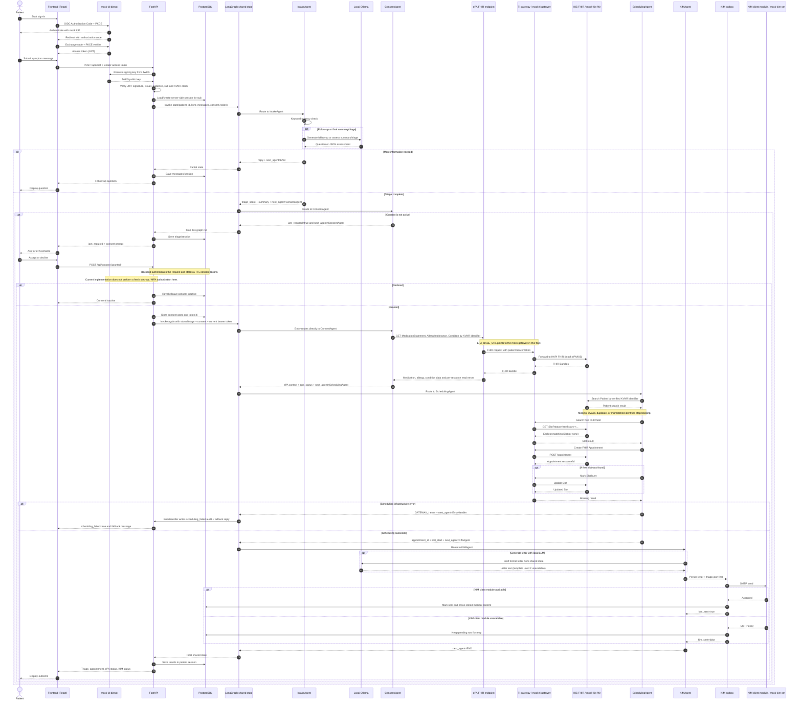

# Patient intake and agent sequence

This sequence documents the prototype patient flow using synthetic data and mock
services. Real ePA authorization and production TI integration are not implemented;
changing endpoints alone does not make the prototype production-ready.

The diagram shows the separate mock OIDC login flow, used by the staging overlay.
The default local Compose stack instead uses the reference Federation BFF login:
the backend resolves the pinned test trust chain, starts PAR with server-side PKCE,
and exchanges the callback code. It validates the encrypted signed ID token before
creating an in-memory HttpOnly cookie session. The browser does not receive the
reference token. A local-only switch permits explicit simulated consent and reads
from the mock ePA without a bearer token; neither the login nor that consent grants
access to a real ePA. Staging does not use this reference BFF.

## Login, intake, consent, booking, and KIM

## What is passed between agents

Agents do not call each other directly. LangGraph passes partial updates to one shared
`IntakeState`; each node returns only the fields it adds or changes.

| Producer | State fields written | Consumer |
|---|---|---|
| API | `patient_id`, verified-token `kvnr`, `messages`, `consent_granted`, `access_token`; on resume, existing triage and summary | IntakeAgent or ConsentAgent |
| IntakeAgent | `reply`, `anamnesis_summary`, `triage_score`, `next_agent` | ConsentAgent, or the API if the graph ends for a follow-up |
| ConsentAgent | `iam_required`, `iam_message`; after consent, medication/allergy/condition context, `epa_status`, `epa_available`, `next_agent` | API/frontend while waiting; otherwise SchedulingAgent and KIMAgent |
| SchedulingAgent | `appointment_id`, `slot_start`, `next_agent`; on failure `scheduling_error` | KIMAgent or ErrorHandler |
| ErrorHandler | `reply`, `scheduling_failed`, `next_agent` | API/frontend |
| KIMAgent | `letter`, `kim_sent`, `next_agent` | API/session and response |

The access token and KVNR are internal graph fields. In the mock OIDC flow, the browser
receives the mock access token and sends it to the API; it is not returned in the graph
response or persisted in the session. In the reference BFF flow, no reference token is
passed to the graph or gateway. ePA and KIS patient searches use the KVNR FHIR identifier
(`http://fhir.de/sid/gkv/kvid-10|<KVNR>`); the mock gateway forwards a bearer token when
present and adds its simulated institutional SMC-B assertion. The backend persists the conversation, consent, and
final result in PostgreSQL; the graph's working state is not itself the durable session.
Scheduling requires exactly one KIS Patient with the matching identifier and a valid FHIR id.
Missing or ambiguous matches result in no appointment and a request to contact the practice;
the OIDC `sub` is not used as a KIS Patient id. This lookup is a prototype mapping, not proof
that a real provider has authorized or implemented the same identity-resolution policy.

## Development mocks and production boundary

- **mock-id-dienst (:8081):** serves the OIDC discovery/JWKS endpoints and issues test tokens.
- **mock-ti-gateway (:8082):** development proxy in front of HAPI; simulates TI gateway identity
  headers/signing. It is not a real Konnektor and does not provide production SMC-B security.
- **mock-kis-fhir / HAPI (:8080):** serves the development FHIR resources, including seeded
  Patient, Slot, MedicationStatement, AllergyIntolerance, and Condition test data.
- **mock-kim-cm (:2525):** accepts SMTP for development and logs captured test messages; it is
  not a production KIM client module and does not deliver through the TI.
- **Production compose:** does not include these mocks. Real clinical use requires more than
  configuring operator-provided endpoints, TLS and credentials: real authorization,
  integration, security and clinical validation remain open.

The current consent endpoint records the authenticated user's boolean decision with a TTL; it
does not launch a separate Gesundheits-ID consent or MFA ceremony. The current backend also does
not distinguish patient, MFA, and administrator roles. Do not treat the mock flow as production
authorization or clinical triage. ePA resources are read independently. HTTP 401 and 403 are recorded
distinctly per resource and do not block scheduling; 403 is not assumed to mean an ePA opt-out.
Allergies and conditions remain separate from the symptom summary and triage score and are labeled
as ePA data in the KIM letter.
